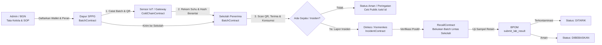
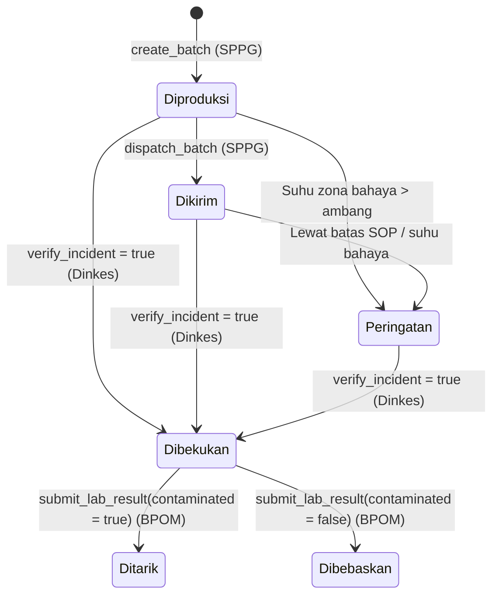

# SIGAP-MBG

> **Sistem Informasi & Garda Akuntabilitas Pangan — Program Makan Bergizi Gratis**  
> Prototipe **Blockchain + IoT** untuk ketertelusuran keamanan pangan *per-batch* dari dapur SPPG hingga siswa di sekolah, dibangun di atas **Solana (Anchor / Rust)** dan **Next.js**.


---

## Daftar Isi

- [Ringkasan Proyek](#ringkasan-proyek)
- [Arsitektur & Alur Kerja](#arsitektur--alur-kerja)
- [Fitur Utama](#fitur-utama)
- [Peran & Model Akses](#peran--model-akses)
- [Halaman Aplikasi Web](#halaman-aplikasi-web)
- [Struktur Direktori](#struktur-direktori)
- [Tech Stack](#tech-stack)
- [Instalasi & Cara Menjalankan](#instalasi--cara-menjalankan)
- [Panduan Alur Demo (1 Wallet)](#panduan-alur-demo-1-wallet)
- [Privasi & Integritas Data](#privasi--integritas-data)
- [Dokumentasi Teknis](#dokumentasi-teknis)

---

## Ringkasan Proyek

**SIGAP-MBG** menyediakan satu sumber kebenaran (*single source of truth*) yang transparan dan tidak dapat dimanipulasi untuk mengawasi rantai pasok pangan Program Makan Bergizi Gratis (MBG) lintas instansi (**BGN**, **Dapur SPPG**, **Sekolah**, **Dinkes/Kemenkes**, dan **BPOM**) sekaligus memberi akses verifikasi publik bagi orang tua dan masyarakat.

Masalah yang diselesaikan:
- **Pelacakan per-batch end-to-end**: bahan baku, pemasok, tanggal kedaluwarsa, jam selesai masak, hingga ID sampel *retain* dicatat on-chain.
- **Pemantauan rantai dingin (IoT)**: data suhu boks/ompreng direkam berkala dengan **hash SHA-256 berantai** (*hash chain*) agar riwayat suhu tidak bisa diubah setelah kejadian.
- **Deteksi pelanggaran SOP otomatis**: smart contract otomatis menandai status `PERINGATAN` jika jeda masak-ke-konsumsi melewati batas SOP BGN atau durasi suhu di zona bahaya melebihi ambang batas.
- **Recall otomatis lintas sekolah**: laporan insiden dicatat sekali untuk semua instansi; begitu diverifikasi oleh Dinkes, seluruh distribusi untuk `batch_id` yang sama otomatis berstatus `DIBEKUKAN` hingga hasil uji lab BPOM menetapkan status akhir (`DITARIK` atau `DIBEBASKAN`).

> Video demo tersedia pada berkas [`SIGAP-MBG-Demo.mp4`](./SIGAP-MBG-Demo.mp4).

---

## Arsitektur & Alur Kerja

Satu program Anchor (`sigap_mbg`, Program ID Devnet: `HvxaHurWiwNmwkrBwDWE5CMCX1JH4VCNeFkAapmqFPfX`) mengimplementasikan empat kontrak logis utama ditambah modul tata kelola *permissioned*:



### Siklus Status Batch (`BatchStatus`)



---

## Fitur Utama

1. **Tata Kelola Permissioned (`initialize`, `update_config`, `set_member`)**
   - Admin (BGN) mengatur parameter keamanan pangan global (default: batas SOP `240` menit, zona bahaya `5,0°C – 60,0°C`, ambang durasi zona bahaya `60` menit).
   - Hanya wallet terdaftar dan aktif yang dapat menulis transaksi sesuai bitmask perannya; publik bebas membaca tanpa wallet.
2. **Manajemen Batch & QR Code (`BatchContract`)**
   - Pencatatan bahan masuk, pemasok, kedaluwarsa bahan (validasi tidak boleh sudah kedaluwarsa saat dimasak), jam selesai masak, porsi, dan ID sampel retain.
   - Pembuatan & cetak label QR otomatis yang mengarah ke `/cek/<batch_id>`, serta pencatatan pengiriman ke banyak sekolah.
   - Konfirmasi penerimaan dan jam konsumsi di sekolah dengan pengecekan otomatis aturan **Batas Waktu SOP** (`consumed_at - cooked_at > sop_max_minutes`).
3. **Rantai Dingin & Simulasi Sensor IoT (`ColdChainContract`)**
   - Merekam hingga 24 pembacaan suhu per transaksi dengan *ring buffer* 48 pembacaan terakhir on-chain (`TempLog`) dan hash SHA-256 berantai (`temp_log_hash`).
   - Mendukung penandatanganan melalui **Wallet SPPG (gateway)** maupun **Perangkat IoT (keypair burner simulasi)** dengan skenario suhu *Hot Holding (>60°C)*, *Rantai Dingin (<5°C)*, *Buruk (zona bahaya)*, mode *backfill* per 5 menit, input manual, dan mode *live* setiap 15 detik.
4. **Pelaporan Insiden, Recall Otomatis & Uji Lab (`IncidentContract` & `RecallContract`)**
   - Sekolah/Dinkes melaporkan insiden beserta hash SHA-256 bukti (foto/dokumen disimpan off-chain).
   - Verifikasi positif oleh Dinkes langsung membuat akun `Recall` dan mengubah status batch menjadi `DIBEKUKAN` sehingga pengiriman/konsumsi baru diblokir on-chain.
   - BPOM mengunggah hash SHA-256 hasil uji lab sampel retain untuk menetapkan status akhir `DITARIK` atau `DIBEBASKAN`.
5. **Verifikasi Publik & Integritas Hash (`/cek` & `/cek/[id]`)**
   - Orang tua dan masyarakat dapat memindai QR boks/ompreng atau memasukkan ID batch tanpa perlu menghubungkan wallet.
   - Menampilkan status keamanan, grafik suhu interaktif, verifikasi kecocokan **hash rantai suhu** di sisi klien, daftar sekolah penerima, serta riwayat insiden & hasil lab.

---

## Peran & Model Akses

Peran dikelola menggunakan *bitmask* `u8` sehingga satu wallet dapat memiliki satu atau beberapa peran sekaligus (sangat memudahkan pengujian/demo).

| Konstanta | Bitmask | Instansi / Aktor | Hak Akses On-Chain |
| --- | :---: | --- | --- |
| `ROLE_SPPG` | `1 << 0` (`1`) | Dapur SPPG | Membuat batch, mengirim ke sekolah, mengunggah suhu batch miliknya |
| `ROLE_SEKOLAH` | `1 << 1` (`2`) | Sekolah Penerima | Konfirmasi terima, catat jam konsumsi, lapor insiden |
| `ROLE_DINKES` | `1 << 2` (`4`) | Dinkes / Puskesmas / Kemenkes | Lapor insiden, verifikasi/tolak insiden & memicu recall |
| `ROLE_BPOM` | `1 << 3` (`8`) | BPOM | Mengunggah hash hasil uji lab sampel retain & menetapkan status akhir |
| `ROLE_SENSOR` | `1 << 4` (`16`) | Perangkat IoT Sensor Suhu | Mengunggah pembacaan suhu (`record_temperatures`) untuk batch |
| `ROLE_BGN` | `1 << 5` (`32`) | Badan Gizi Nasional | Peran pengawas (admin program mengelola `config` & `set_member`) |

---

## Halaman Aplikasi Web

| Rute | Pengguna | Fungsi Utama |
| --- | --- | --- |
| `/` | Publik / Semua | Ringkasan statistik on-chain, pencarian ID batch, alur data, dan daftar batch terbaru |
| `/admin` | Admin (BGN) | Inisialisasi program, pengaturan parameter SOP & zona bahaya, registrasi/edit peran wallet |
| `/sppg` | Dapur SPPG | Buat batch baru, cetak QR, catat pengiriman ke sekolah, simulator & grafik sensor suhu |
| `/sekolah` | Sekolah | Scan QR kamera / input ID batch, konfirmasi terima, catat jam konsumsi, lapor insiden |
| `/dinkes` | Dinkes / Kemenkes | Daftar laporan insiden, investigasi ringkasan batch, verifikasi (picu recall) atau tolak |
| `/bpom` | BPOM | Daftar batch dalam recall, unggah file hasil lab (hanya hash SHA-256 on-chain), tetapkan status akhir |
| `/cek` | Publik / Orang Tua | Pencarian manual ID batch & pemindai QR kamera tanpa wallet |
| `/cek/[id]` | Publik / Orang Tua | Detail lengkap batch, grafik suhu, verifikasi hash rantai suhu, distribusi sekolah, riwayat insiden & lab |

---

## Struktur Direktori

```text
SIGAP-MBG/
├── Anchor.toml                     # Konfigurasi workspace Anchor & Program ID Devnet
├── Cargo.toml                      # Rust workspace manifest
├── rust-toolchain.toml             # Versi toolchain Rust (1.89.0)
├── SIGAP-MBG-Demo.mp4              # Video demo aplikasi
├── docs/
│   └── SMART_CONTRACT.md           # Spesifikasi teknis PDA, akun, instruksi, event & error
├── programs/
│   └── sigap_mbg/
│       ├── Cargo.toml
│       └── src/
│           └── lib.rs              # Smart contract Anchor (4 kontrak logis)
└── app/                            # Aplikasi web Next.js (App Router)
    ├── next.config.mjs
    ├── package.json
    └── src/
        ├── app/
        │   ├── page.tsx            # Beranda & daftar batch
        │   ├── admin/page.tsx      # Tata kelola admin BGN
        │   ├── sppg/page.tsx       # Dapur SPPG + QR + Simulator IoT
        │   ├── sekolah/page.tsx    # Penerimaan, konsumsi & lapor insiden
        │   ├── dinkes/page.tsx     # Verifikasi insiden & pemicu recall
        │   ├── bpom/page.tsx       # Uji lab sampel retain
        │   └── cek/
        │       ├── page.tsx        # Halaman cari / scan QR publik
        │       └── [id]/page.tsx   # Detail ketertelusuran publik per-batch
        ├── components/
        │   ├── Providers.tsx       # Solana Connection & Wallet Standard Provider
        │   ├── QrScanner.tsx       # Scanner QR berbasis kamera (html5-qrcode)
        │   ├── TempChart.tsx       # Grafik riwayat suhu & zona bahaya
        │   └── ui.tsx              # Komponen UI (Card, StatusBadge, RoleGate, TxMessage)
        ├── idl/
        │   └── sigap_mbg.json      # Anchor IDL hasil build untuk frontend
        └── lib/
            ├── sigap.ts            # Helper PDA, konstanta peran, SHA-256 & verifikasi hash chain
            └── hooks.ts            # React hooks (useProgram, useSigap, useTx)
```

---

## Tech Stack

- **Blockchain & Smart Contract**: Solana (Devnet), Rust `1.89.0`, Anchor `1.2.2`, `solana-sha256-hasher`
- **Frontend**: Next.js `16.4` (App Router), React `19`, TypeScript `5.9`
- **Integrasi Solana Web**: `@anchor-lang/core`, `@solana/web3.js`, `@solana/wallet-adapter-react` (mendukung Wallet Standard: Phantom, Solflare, Backpack, dll.)
- **QR Code**: `qrcode.react` (generator & cetak) dan `html5-qrcode` (pemindai kamera)

---

## Instalasi & Cara Menjalankan

### Prasyarat

- **Node.js** `>= 20` & **npm**
- **Rust** `1.89.0` (otomatis dibaca dari `rust-toolchain.toml`)
- **Solana CLI** & **Anchor CLI** (hanya diperlukan jika ingin build/deploy ulang smart contract)
- Ekstensi browser wallet Solana (**Phantom**, **Solflare**, atau **Backpack**) yang disetel ke jaringan **Devnet**

### 1. Build & Deploy Smart Contract (Opsional jika ingin deploy program sendiri)

Pastikan Solana CLI & Anchor CLI berada di `PATH`:

```bash
export PATH="$HOME/.local/share/solana/install/active_release/bin:$HOME/.cargo/bin:$PATH"
```

Siapkan wallet Devnet dan isi saldo Devnet (~2–3 SOL gratis):

```bash
solana config set --url devnet
solana-keygen new   # lewati jika ~/.config/solana/id.json sudah ada
solana airdrop 2
```

> Jika faucet CLI sedang terkena batas limit, minta SOL Devnet gratis melalui [faucet.solana.com](https://faucet.solana.com) ke alamat hasil `solana address`.

Build, salin IDL ke frontend, lalu deploy ke Devnet:

```bash
anchor build
cp target/idl/sigap_mbg.json app/src/idl/sigap_mbg.json
anchor deploy --provider.cluster devnet
```

> Jika Program ID berubah setelah membuat keypair baru, jalankan `anchor keys sync` sebelum `anchor build`.

### 2. Konfigurasi & Jalankan Aplikasi Web (Next.js)

```bash
cd app
npm install
npm run dev
```

Buka [http://localhost:3000](http://localhost:3000) di browser.

#### Variabel Lingkungan (Opsional)

Buat berkas `app/.env.local` jika ingin mengarahkan aplikasi ke RPC atau cluster lain (misalnya RPC privat atau `localnet`):

```env
NEXT_PUBLIC_RPC_URL=https://api.devnet.solana.com
NEXT_PUBLIC_CLUSTER=devnet
```

---

## Panduan Alur Demo (1 Wallet)

Seluruh siklus hidup pangan dapat didemonstrasikan menggunakan **satu wallet** pada jaringan Devnet:

1. **Inisialisasi (`/admin`)**
   - Hubungkan wallet → klik **Inisialisasi sebagai Admin** → klik **Beri saya semua peran (demo)** agar wallet memiliki seluruh peran (`SPPG`, `SEKOLAH`, `DINKES`, `BPOM`, `SENSOR`, `BGN`).
2. **Produksi, Distribusi & Sensor Suhu (`/sppg`)**
   - Buat batch baru → lihat/cetak label QR.
   - Kirim batch ke alamat wallet Anda sendiri (simulasi sekolah penerima).
   - Pada panel **Sensor suhu boks**, pilih skenario **Buruk** lalu unggah buffer suhu (atau aktifkan mode *Perangkat IoT* untuk simulasi pengiriman *live* tiap 15 detik) hingga durasi zona bahaya memicu status `PERINGATAN`.
3. **Penerimaan, Konsumsi & Laporan Insiden (`/sekolah`)**
   - Pilih batch dari daftar kiriman atau scan QR.
   - Klik **Konfirmasi makanan diterima** → catat **Jam konsumsi siswa** (coba lewatkan batas SOP untuk memicu flag `LEWAT SOP`).
   - Kirim **Laporan insiden** (opsional lampirkan file bukti; hanya hash SHA-256 yang masuk ke blockchain).
4. **Verifikasi & Recall Otomatis (`/dinkes`)**
   - Buka laporan insiden yang masuk → isi catatan investigasi → klik **Verifikasi → Recall batch**.
   - Status batch otomatis berubah menjadi `DIBEKUKAN` di seluruh sekolah penerima.
5. **Uji Lab Sampel Retain (`/bpom`)**
   - Pilih dokumen hasil uji lab untuk batch yang dibekukan → klik **Terkontaminasi** (status menjadi `DITARIK`) atau **Aman** (status menjadi `DIBEBASKAN`).
6. **Verifikasi Publik (`/cek/<batch_id>`)**
   - Buka halaman publik (dapat diakses tanpa wallet) untuk melihat status akhir, grafik suhu, hasil verifikasi otomatis **hash rantai suhu**, tabel distribusi sekolah, dan lini masa insiden/lab.

---

## Privasi & Integritas Data

- **Tanpa data pribadi siswa on-chain**: blockchain hanya mencatat data agregat per-batch (ID batch, menu, suhu, jumlah porsi, jumlah terdampak).
- **Dokumen off-chain dengan bukti hash SHA-256**: bukti foto/dokumen insiden dan laporan uji lab BPOM di-hash di browser menggunakan Web Crypto API (`SHA-256`); hanya digest 32-byte yang disimpan on-chain untuk menjaga privasi dan efisiensi biaya.
- **Rantai hash suhu (*Tamper-evident*)**: setiap pembacaan suhu menghitung `H_n = SHA256(H_{n-1} || ts_le64 || temp_x10_le16)` secara on-chain dan dapat diverifikasi ulang oleh siapa saja di halaman `/cek/[id]`.

---

## Dokumentasi Teknis

Untuk rincian lengkap mengenai struktur akun on-chain, derivasi PDA (*Program Derived Address*), daftar instruksi, event, dan kode error smart contract, lihat [`docs/SMART_CONTRACT.md`](./docs/SMART_CONTRACT.md).
